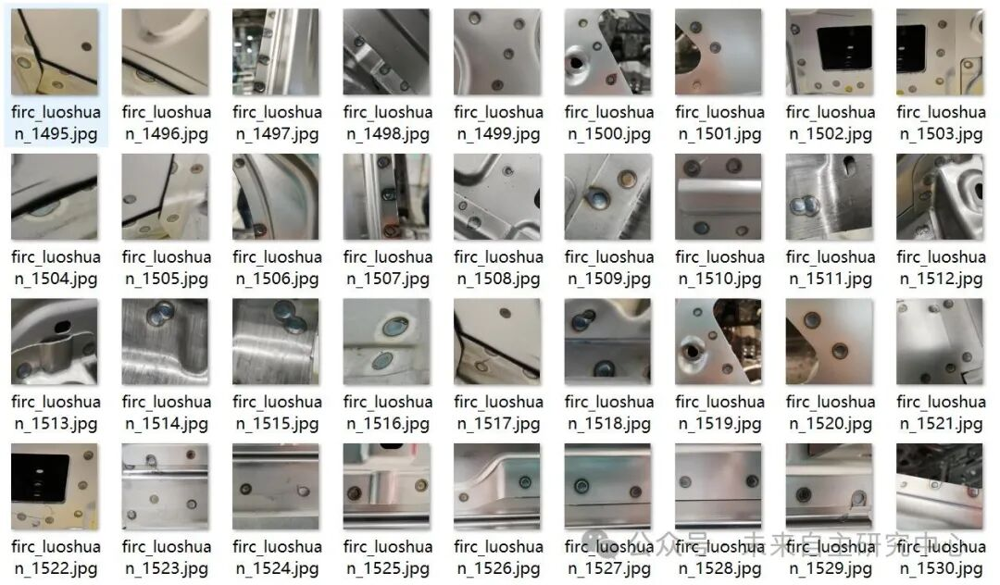
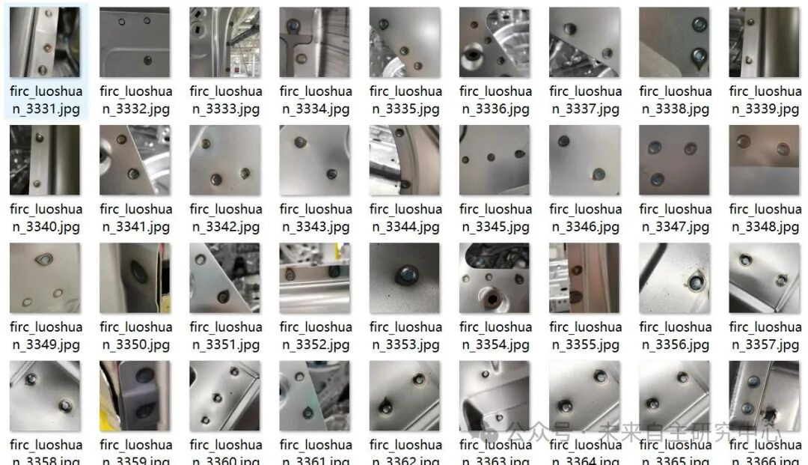
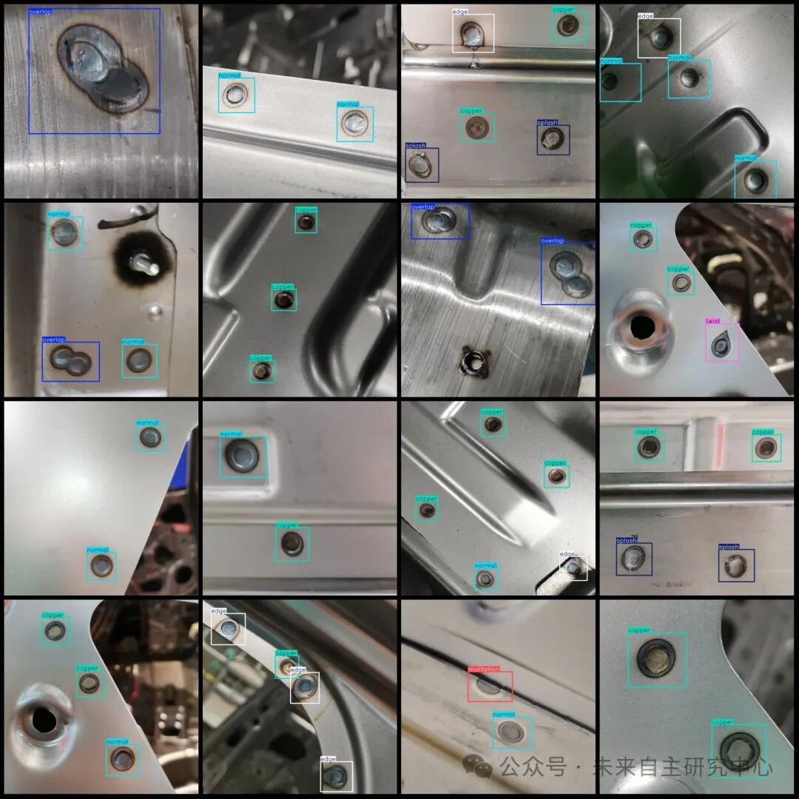

# Dataset for Detecting Welding Defects and Flaws in Bolts: VOC+YOLO format with 4134 images across 7 categories

Dataset format: Pascal VOC format + YOLO format (txt file without split path, only containing jpg images and corresponding VOC format xml files and yolo format txt files)

Number of images (number of jpg files): 4134

Number of annotations (number of xml files): 4134

Number of annotations (number of txt files): 4134

Annotation Category Count: 8

Label category names (note that the order of yolo format categories does not correspond to this, but is based on the labels folder's classes.txt): ["copper", "edge", "fake", "mutilation", "normal", "overlap", "splash", "twist"]

Number of boxes labeled in each category:

Copper frame count = 2586

Edge box count = 1861

Fake Frames = 42

Mutilation frame count = 807

Normal frame count = 4506

Overlapping Frame Count = 824

Splash frame count = 755

Twist frame count = 346

Total frame count: 11727

Using labelImg:

Annotation rules: Draw a rectangle around the category.

Important Notice: No

Special : This dataset does not guarantee the accuracy or precision of the trained models or weight files. The dataset is provided with accurate and reasonable annotations only.

Image Preview:

Annotation example:

## Payment

Here is a pay link on Stripe ( https://buy.stripe.com/3cs8yP7sY87d0vu9AB ). Please contact me lonlonago@foxmail.com after funding $89, and I will send you a complete data files , thank you!

